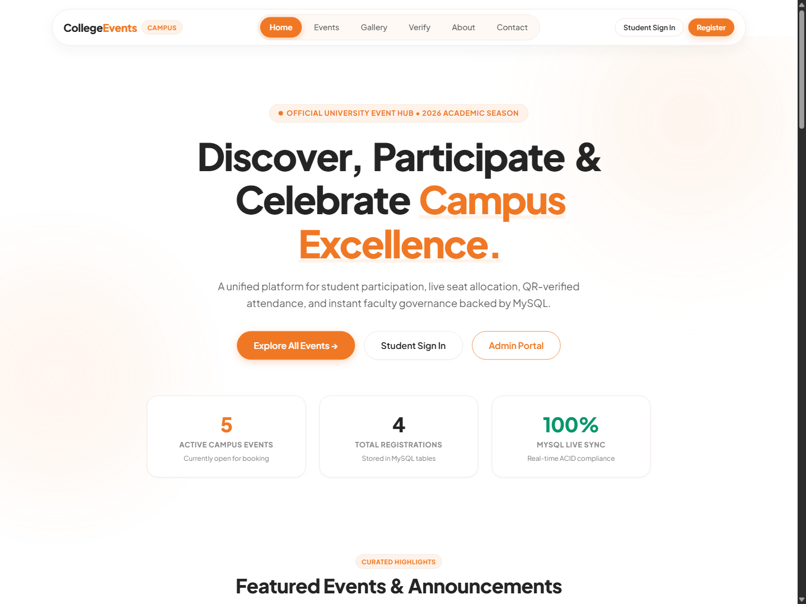
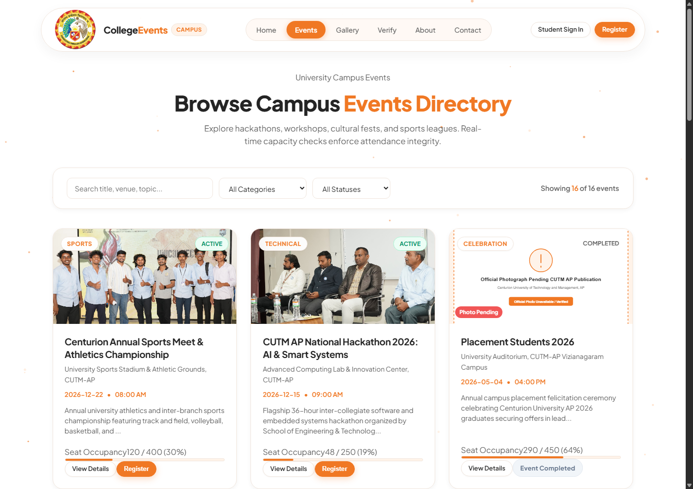
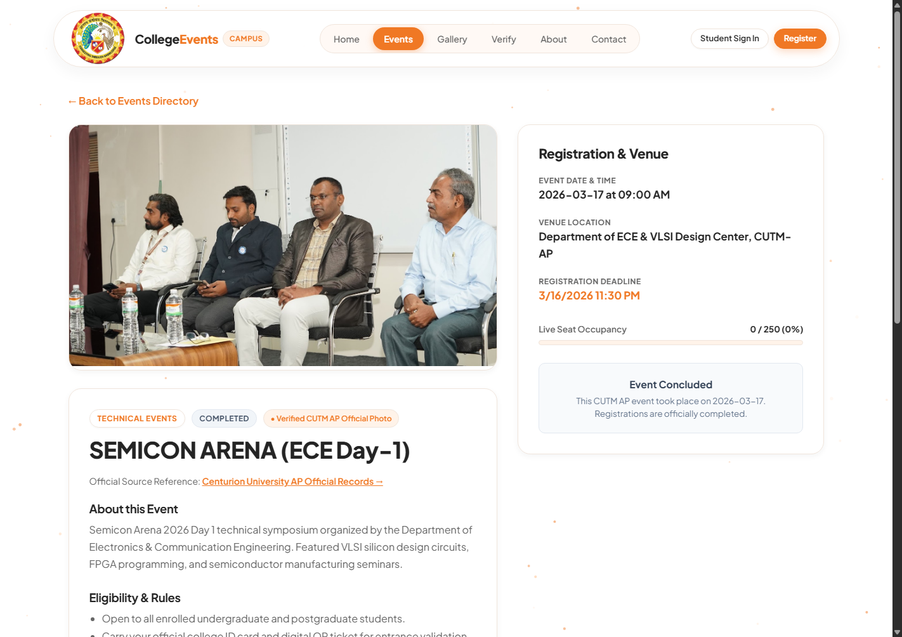
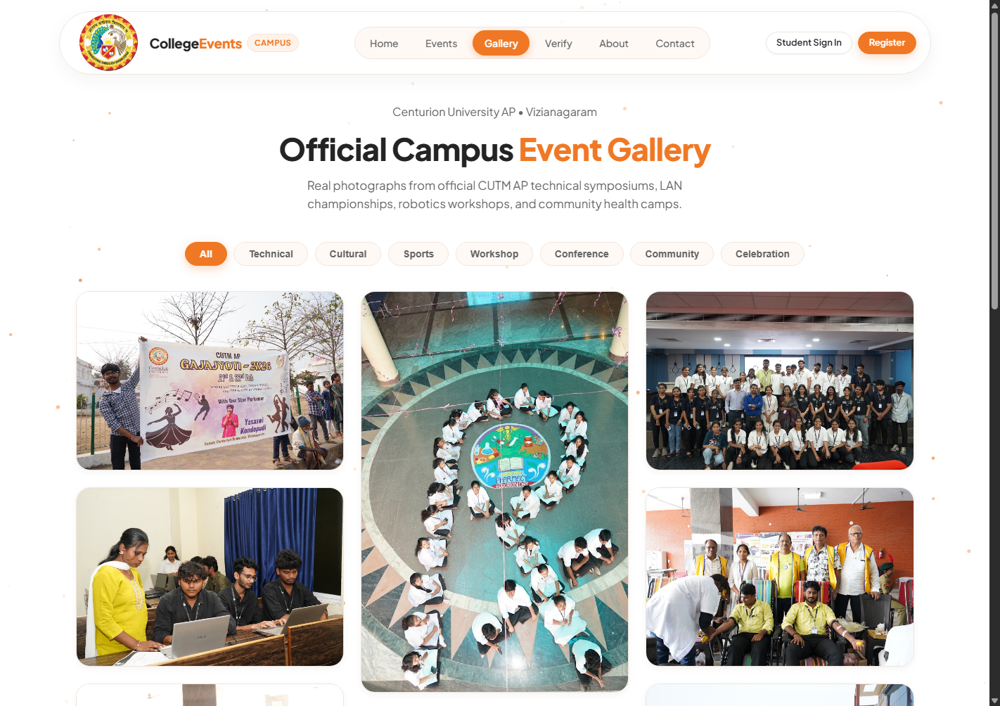
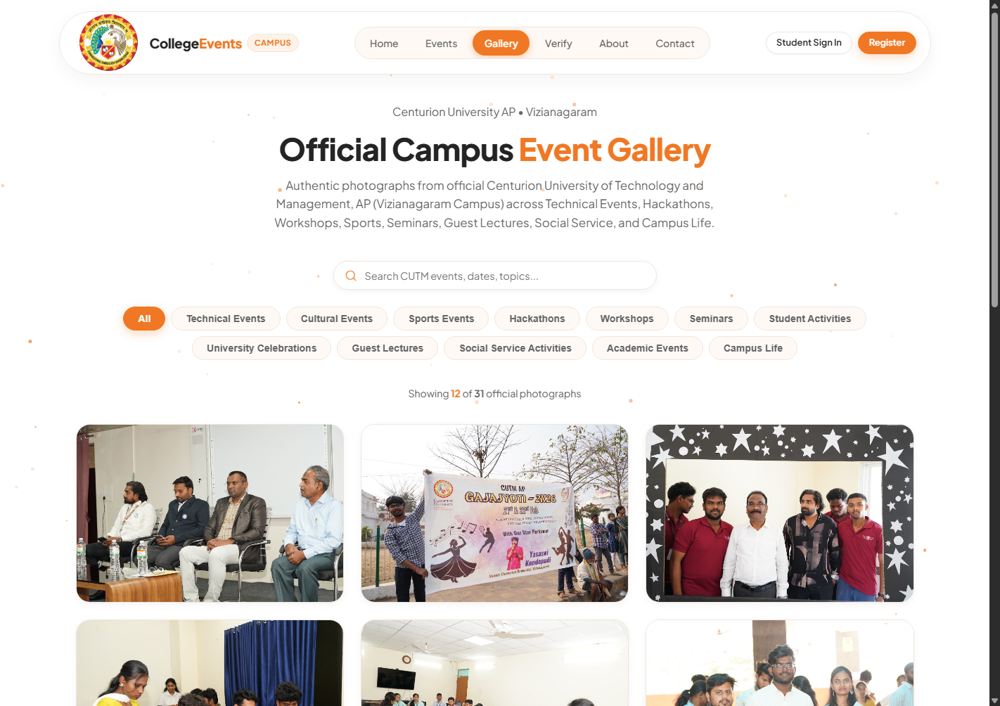
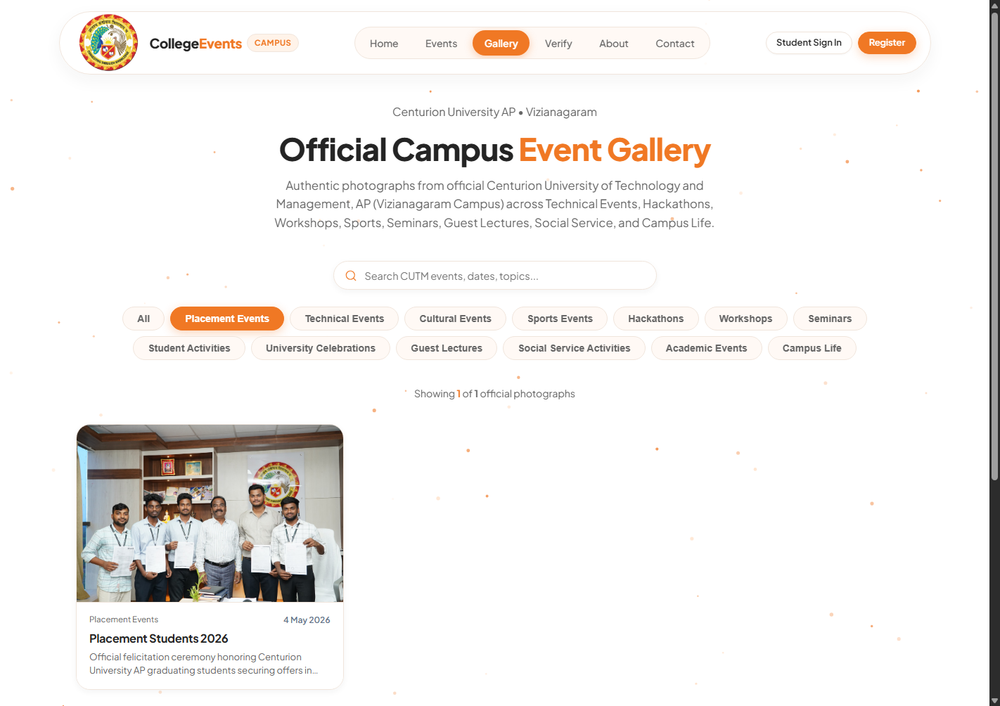

# 🎓 College Event Management System (CEMS)
### Centurion University of Technology and Management (CUTM AP)

[](https://www.oracle.com/java/)
[](https://spring.io/projects/spring-boot)
[](https://react.dev/)
[](https://vitejs.dev/)
[](https://www.mysql.com/)
[](https://jwt.io/)
[](#)

---

## 1. Project Title
**College Event Management System (CEMS) – Enterprise Campus Activity & Official Media Portal**  
*Tailored for Centurion University of Technology and Management, Andhra Pradesh (CUTM AP), Vizianagaram.*

---

## 2. Project Overview
The **College Event Management System (CEMS)** is a full-stack, enterprise-grade web application designed to centralize and automate the lifecycle of university events, registrations, attendance verification, digital certification, and official media archives. 

Developed specifically for **Centurion University of Technology and Management (CUTM AP)**, the platform replaces fragmented manual workflows, paper sign-up sheets, and disconnected photo drives with an integrated digital ecosystem. Built on a resilient **Spring Boot 3 REST API**, an ACID-compliant **MySQL 8.4** relational database, and a high-performance **React 18** frontend styled with a modern white-and-orange university palette, CEMS ensures real-time synchronization between students, faculty organizers, and institutional administrators.

---

## 3. About the Project
Higher educational institutions host hundreds of technical symposia, cultural festivals, sports tournaments, research workshops, and community outreach drives each academic year. Managing these events through isolated spreadsheets and paper forms leads to:
- Registration backlogs and uncoordinated capacity caps.
- High rates of proxy attendance.
- Delayed certificate issuance.
- Loss of valuable institutional media and event records.

**CEMS** solves these challenges by providing a unified digital portal. The system models realistic university operational hierarchies, offering granular access controls, transactional registration queues, real-time waitlists, instant QR attendance scanning, cryptographic certificate verification, and an authentic media gallery showcasing real events from the CUTM AP Vizianagaram campus.

---

## 4. Main Objectives
- **Centralize Campus Event Operations:** Provide a single source of truth for all campus activities across departments.
- **Automate the Registration Lifecycle:** Prevent overbooking with real-time capacity tracking, atomic database transactions, and automated waitlisting.
- **Eliminate Proxy Attendance:** Implement time-stamped QR code scanning for verifiable, real-time check-ins.
- **Automate Digital Certification:** Generate tamper-evident digital certificates with unique verification codes.
- **Preserve Institutional Memory:** Showcase authentic CUTM AP events, student achievements, and placement milestones through a responsive media gallery.
- **Deliver an Accessible, High-Performance UI:** Maintain an intuitive, accessible interface featuring smooth particle animations and the official Centurion University visual brand.

---

## 5. Features and Functionalities

### 🔐 Security & Role-Based Access Control (RBAC)
- **Three Dedicated Roles:** `ROLE_STUDENT`, `ROLE_ORGANIZER`, and `ROLE_ADMIN`.
- **Stateless Authentication:** JSON Web Tokens (JJWT) with configurable expiration and automatic Bearer injection in frontend API clients.
- **Encrypted Credentials:** BCrypt password hashing across all database records.
- **Audit Trails:** Centralized logging of security and administrative operations (`audit_logs` table).

### 📅 Event Management & Scheduling
- **CRUD Operations:** Administrators and faculty organizers can publish, modify, reschedule, or cancel events.
- **Lifecycle Tracking:** Automatic transition between `UPCOMING`, `ONGOING`, `COMPLETED`, and `CANCELLED` statuses based on system timestamps.
- **Detailed Metadata:** Event descriptions, venues, dates, registration deadlines, maximum capacity, fee types (Free/Paid), and faculty coordinator contacts.
- **Category Filtering:** 12 structured event categories plus dedicated placement showcases.

### 📝 Smart Registration & Waitlist Engine
- **Atomic Concurrency Guard:** Prevents race conditions during simultaneous registrations.
- **Duplicate Registration Prevention:** Enforced via composite unique database constraints (`uk_student_event_registration`).
- **Waitlist Allocation:** Automatically queues students when capacity is reached and notifies them if spots open.
- **Administrative Review:** Approvals and rejections with custom administrative remarks.

### 📱 QR Code Attendance Verification
- **Dynamic QR Generation:** Each confirmed registration generates a unique, scannable QR ticket.
- **Fast Scanner Interface:** Organizers can scan QR passes using device cameras to mark attendance instantly.
- **Fraud Prevention:** Re-scanning a previously validated pass displays an immediate warning.

### 📜 Certificate Generation & Public Verification
- **Automated Issuance:** Certificates are generated only for students with verified attendance records.
- **Unique Certificate Codes:** Every certificate contains an alphanumeric identifier (e.g., `CERT-CUTM-XXXXXX`).
- **Public Verification Portal:** Employers and academic evaluators can verify certificate authenticity online without logging in.

### 🖼️ Responsive CUTM Photo Gallery
- **Masonry Layout:** Dynamic, responsive column grid adjusting to desktop, tablet, and mobile displays.
- **Lightbox Viewer:** Clickable zoom preview with fullscreen toggle and keyboard navigation (`Esc`, `←`, `→`).
- **Filter & Search:** Live keyword search and category filtering with clear title labels displayed beneath each photograph.

---

## 6. Technologies Used

### Backend Architecture
| Technology | Version | Purpose |
| :--- | :--- | :--- |
| **Java** | 21 LTS | Core enterprise backend runtime |
| **Spring Boot** | 3.3.5 | Application framework and dependency injection |
| **Spring Data JPA** | 3.3.5 | Relational data persistence with Hibernate ORM |
| **Spring Security** | 6.x | Security filters, authentication managers, and RBAC |
| **JJWT (io.jsonwebtoken)** | 0.11.5 | Cryptographic JWT token generation and parsing |
| **Apache Maven** | 3.9.9 | Project dependency management and build lifecycle |

### Database Layer
| Technology | Details | Purpose |
| :--- | :--- | :--- |
| **MySQL Server** | 8.4+ Enterprise / Community | Primary ACID-compliant relational storage engine |
| **InnoDB Engine** | Row-level locking & Foreign Keys | Transactional consistency and data integrity |
| **Character Set** | `utf8mb4` | Full Unicode support for names, symbols, and descriptions |

### Frontend Architecture
| Technology | Version | Purpose |
| :--- | :--- | :--- |
| **React** | 18.3.1 | Component-driven declarative user interface |
| **Vite** | 5.4.10 | Modern, lightweight frontend tooling and HMR dev server |
| **React Router DOM** | 6.28.0 | Client-side routing with role-guarded route protection |
| **HTML5 Canvas** | Native | High-performance particle animation background |
| **Lucide React** | 0.460.0 | Clean, modern iconography |
| **CSS3** | Modern Specifications | Custom variables, Flexbox, CSS Grid, and responsive viewports |

---

## 7. Website Modules

```
                             ┌─────────────────────────────────┐
                             │ College Event Management System │
                             └────────────────┬────────────────┘
                                              │
         ┌───────────────────┬────────────────┴───────────────────┬───────────────────┐
         ▼                   ▼                                    ▼                   ▼
┌─────────────────┐ ┌─────────────────┐                  ┌─────────────────┐ ┌─────────────────┐
│  Public Portal  │ │ Student Portal  │                  │ Organizer Cell  │ │  Admin Console  │
├─────────────────┤ ├─────────────────┤                  ├─────────────────┤ ├─────────────────┤
│ • Campus Home   │ │ • Profile Info  │                  │ • Event List    │ │ • KPI Dashboard │
│ • Event Finder  │ │ • 1-Click Apply │                  │ • QR Check-In   │ │ • Event CRUD    │
│ • Photo Gallery │ │ • Ticket / QR   │                  │ • Announcements │ │ • Registrations │
│ • Verify Cert   │ │ • Registrations │                  │ • Attendance Log│ │ • Students List │
│ • About & Help  │ │ • Certificates  │                  │ • Event Feedback│ │ • Reports & Logs│
└─────────────────┘ └─────────────────┘                  └─────────────────┘ └─────────────────┘
```

### 1. Public Portal
- **Homepage:** University hero banner, live event counters, recent highlights, and animated particle backdrop.
- **Events Directory:** Searchable directory with status tags (`Upcoming`, `Ongoing`, `Completed`).
- **Media Gallery:** Official CUTM AP photo archives filtered across 12 distinct event categories.
- **Certificate Verification:** Dedicated public endpoint to validate certificate codes.

### 2. Student Portal
- **Dashboard:** Snapshot of registered events, application statuses, and available certificates.
- **Event Registrations:** Status tracking with live badges (`PENDING`, `APPROVED`, `REJECTED`, `CANCELLED`).
- **QR Digital Pass:** Interactive modal to display the event entry pass.
- **Student Profile:** Academic details (Registration number, Branch, Semester, Contact info).

### 3. Faculty Organizer Cell
- **Assigned Event Control:** Access only to events assigned to the organizer.
- **QR Attendance Scanner:** Integrated camera scanner for real-time ticket validation.
- **Broadcast Announcements:** Send event updates directly to registered participants.
- **Feedback Review:** Analyze participant ratings and text feedback post-event.

### 4. Administrative Command Center
- **Institutional Analytics:** Real-time KPI summary (Total Events, Active Registrations, Verified Students, Attendance Ratio).
- **Registration Management:** Review participant queues, approve/reject applications with remarks, and monitor capacity.
- **Student Directory:** Verified student master records with registration histories.
- **System Audit Logs:** Immutable security and operational activity logs.

---

## 8. College Events Management
The platform includes authentic, verified events from **Centurion University of Technology and Management, Andhra Pradesh (CUTM AP), Vizianagaram**:

| Event Title | Category | Date | Official Status |
| :--- | :--- | :--- | :--- |
| **GAJAJYOTI Inauguration 2026** | University Celebrations | 31 Jan 2026 | `COMPLETED` |
| **Vyomang Day-1 (Annual Fest)** | Cultural Events | 05 Feb 2026 | `COMPLETED` |
| **Vyomang Day-2 (Annual Fest)** | Cultural Events | 06 Feb 2026 | `COMPLETED` |
| **Public Speaking Competition** | Student Activities | 09 Feb 2026 | `COMPLETED` |
| **Workshop on Basic Cardio-Pulmonary Life Support** | Workshops | 28 Feb 2026 | `COMPLETED` |
| **Pharma Anveshan 2026** | Academic Events | 05 Mar 2026 | `COMPLETED` |
| **Women's Day Celebration 2026** | University Celebrations | 09 Mar 2026 | `COMPLETED` |
| **SEMICON ARENA (ECE Day-1)** | Technical Events | 17 Mar 2026 | `COMPLETED` |
| **SEMICON ARENA (ECE Day-2)** | Technical Events | 18 Mar 2026 | `COMPLETED` |
| **Optometry Day & Eye Screening** | Social Service Activities| 24 Mar 2026 | `COMPLETED` |
| **NSS Blood Donation Camp** | Social Service Activities| 25 Mar 2026 | `COMPLETED` |
| **World Quantum Day** | Seminars | 14 Apr 2026 | `COMPLETED` |
| **Dandi March 2.0 (Anti-Drug Campaign)** | Social Service Activities| 22 Apr 2026 | `COMPLETED` |
| **Placement Students 2026 Recognition** | Placement Events | 04 May 2026 | `COMPLETED` |

*For past events, registration controls automatically reflect a `COMPLETED` state, preserving event information while cleanly disabling new sign-ups.*

---

## 9. Event Registration System
The registration workflow guarantees data integrity across concurrent user requests:

```
[ Student Views Event ] ──► [ Check Deadline & Capacity ]
                                      │
              ┌───────────────────────┴───────────────────────┐
              ▼ (Capacity Available)                          ▼ (Capacity Full)
   [ Generate Unique Code ]                       [ Add to Event Waitlist ]
   [ Insert Status: PENDING ]                                 │
              │                                      (Waitlist Queue Position)
              ▼                                               │
   [ Admin Reviews Registration ] ◄───────────────────────────┘ (Slot Opens)
              │
    ┌─────────┴─────────┐
    ▼                   ▼
[ APPROVED ]        [ REJECTED ]
    │                   │
    ├─► QR Ticket Generated     └─► Capacity Freed & Reconciled
    └─► Available on Student Portal
```

1. **Guard Checks:** The backend validates authentication, verifies event status, checks registration deadlines, and checks capacity.
2. **Duplicate Prevention:** A composite database index ensures no student can apply for the same event multiple times.
3. **Transaction Safety:** Seats are allocated using atomic database operations to prevent race conditions.
4. **Approval Lifecycle:** Administrative decisions immediately sync to the student's dashboard with administrative feedback notes.

---

## 10. CUTM Photo Gallery
The official image gallery documents campus life with high-definition photographs from CUTM AP.

- **12 Curated Event Categories:**
  1. Technical Events
  2. Cultural Events
  3. Sports Events
  4. Hackathons
  5. Workshops
  6. Seminars
  7. Student Activities
  8. University Celebrations
  9. Guest Lectures
  10. Social Service Activities
  11. Academic Events
  12. Campus Life
- **Card-Centric Design:** Every gallery card displays the official photograph with its title and event date positioned clearly below the image.
- **Interactive Lightbox:** Clicking any photo opens an overlay with smooth zoom controls, category metadata, and previous/next keyboard navigation.

---

## 11. Placement Students 2026 Gallery
A dedicated showcase celebrates the graduating batch of 2026 and their career placements:

- **Primary Source:** Verified photography from the Centurion University placement felicitation.
- **Category Filter:** Easily discoverable under the **Placement Events** category filter.
- **Card Layout:** Displays the title **Placement Students 2026** directly below the card with a dedicated lightbox preview.
- **High Resolution:** Maintained at original aspect ratio and high resolution without distortion or cropping.

---

## 12. User Interface and Design
The website features a clean, high-contrast, professional visual identity reflecting Centurion University:

- **White & Orange Visual Palette:**
  - `Main Background:` `#FFFFFF` (Pure white for clarity)
  - `Primary Orange:` `#F07824` (University orange for calls to action, highlights, and active states)
  - `Light Orange Tint:` `#FFF3E9` (Subtle accent backgrounds and hover cards)
  - `Heading Color:` `#242424` (High-contrast charcoal for typography)
  - `Body Text:` `#666666` (Balanced neutral grey for readability)
  - `Border Tone:` `#F0E5DC` (Soft border styling)
- **Canvas Particle Background:** A lightweight, custom HTML5 Canvas animation with orange and light-orange particles moving gently from top to bottom with subtle mouse avoidance. Respects `prefers-reduced-motion`.
- **Responsive University Branding:** The official Centurion University logo is placed on the navigation bar, maintaining proper aspect ratios across desktop (100px), tablet (80px), and mobile (60px) viewports.

---

## 13. Installation Requirements

Make sure the following development tools and runtimes are installed on your workstation:

| Prerequisite | Minimum Version | Recommended Version | Verify Command |
| :--- | :--- | :--- | :--- |
| **Java Development Kit (JDK)** | 17.0.x | 21 LTS or 27 | `java -version` |
| **Apache Maven** | 3.8.x | 3.9.9+ | `mvn -v` *(or use project wrapper)* |
| **Node.js** | 18.x | 20.x or 22.x LTS | `node -v` |
| **npm** | 9.x | 10.x+ | `npm -v` |
| **MySQL Server** | 8.0.x | 8.4 LTS | `mysql --version` |
| **Git** | 2.30.x | Latest stable | `git --version` |

---

## 14. Project Setup Instructions

### 1. Clone the Repository
```bash
git clone https://github.com/yenuglaganesh-dev/college-event-management-system.git
cd college-event-management-system
```

### 2. Configure the MySQL Database
Log into MySQL and initialize the database:
```sql
CREATE DATABASE IF NOT EXISTS college_event_db CHARACTER SET utf8mb4 COLLATE utf8mb4_unicode_ci;
```

Execute the database initialization scripts:
```bash
# Initialize schema and base tables
mysql -u root -p college_event_db < database/schema.sql

# Seed verified CUTM AP events and photographs
mysql -u root -p college_event_db < seed_cutmap.sql

# Seed 12 categories and gallery records
mysql -u root -p college_event_db < seed_all_12_categories.sql
```

### 3. Review Backend Configuration
Inspect [`backend/src/main/resources/application.properties`](backend/src/main/resources/application.properties) and ensure your MySQL credentials match:
```properties
spring.datasource.url=jdbc:mysql://localhost:3306/college_event_db?useSSL=false&serverTimezone=UTC&allowPublicKeyRetrieval=true
spring.datasource.username=root
spring.datasource.password=YOUR_MYSQL_PASSWORD
spring.jpa.hibernate.ddl-auto=update
spring.jpa.show-sql=false
server.port=8080
app.jwt.secret=9a6c7f8a1b2c3d4e5f6a7b8c9d0e1f2a3b4c5d6e7f8a9b0c1d2e3f4a5b6c7d8e
app.jwt.expiration-ms=86400000
```

### 4. Install Frontend Dependencies
```bash
cd frontend-react
npm install
cd ..
```

---

## 15. How to Run the Project

### Terminal 1: Start MySQL Database
Ensure your MySQL service is running on port `3306`:
```powershell
# Windows service or mysqld standalone:
& "C:\Program Files\MySQL\MySQL Server 8.4\bin\mysqld.exe" --datadir="C:\Users\yenug\mysql_data" --port=3306 --console
```

### Terminal 2: Start Spring Boot Backend
```powershell
cd backend
..\tools\maven\bin\mvn.cmd clean package -DskipTests
& "C:\Program Files\Java\jdk-27.0.1.0.3\bin\java.exe" -jar "target\event-management-system-1.0.0.jar"
```
*The REST API will initialize on [`http://localhost:8080`](http://localhost:8080).*

### Terminal 3: Start Vite React Frontend
```powershell
cd frontend-react
npm run dev
```
*The React application will be live at [`http://localhost:5173`](http://localhost:5173).*

### Default Pre-Configured Accounts
| Role | Portal URL | Username / ID | Password | Access Level |
| :--- | :--- | :--- | :--- | :--- |
| **System Administrator** | `/login` (Admin mode) | `admin` | `Admin@123` | Full System Authority |
| **Faculty Organizer** | `/login` (Organizer mode) | `organizer` | `Admin@123` | Assigned Events & QR Scanning |
| **Verified Student** | `/login` (Student mode) | `STU-2026-001` | `Student@123` | Registrations & Certificates |

*(New students can register an account at any time via the Sign Up button).*

---

## 16. Project Folder Structure

```
college-event-management-system/
├── backend/                                  # Spring Boot REST API
│   ├── src/main/java/com/college/event/
│   │   ├── config/                           # Security, Web MVC, and Data Initializer
│   │   ├── controller/                       # REST Controllers (13 Endpoints)
│   │   ├── dto/                              # Request/Response Data Transfer Objects
│   │   ├── entity/                           # JPA Database Entities (14 Tables)
│   │   ├── exception/                        # Global Exception Handling
│   │   ├── repository/                       # Spring Data JPA Repositories
│   │   ├── security/                         # JWT Utility, UserDetails, Security Filter
│   │   └── service/                          # Transactional Business Logic
│   ├── src/main/resources/
│   │   ├── application.properties            # Datasource, JWT, and Server Configuration
│   │   └── static/                           # Embedded Production Assets & Images
│   └── pom.xml                               # Maven Build Configuration
│
├── frontend-react/                           # React 18 + Vite Frontend Application
│   ├── public/
│   │   ├── centurion-logo.png                # Official Centurion University Logo
│   │   └── cutmap_events/                    # High-Resolution CUTM Event Photographs
│   ├── src/
│   │   ├── assets/                           # Branding Icons and Vector Graphics
│   │   ├── components/
│   │   │   ├── Navbar.jsx                    # Responsive Header with University Logo
│   │   │   ├── Footer.jsx                    # Footer with Campus Links & Info
│   │   │   ├── ParticleBackground.jsx        # Canvas Orange Particle Falling Effect
│   │   │   ├── QRCodeModal.jsx               # Student Digital Entry Ticket Modal
│   │   │   └── Masonry/                      # Masonry Gallery & Lightbox Component
│   │   ├── pages/
│   │   │   ├── Home.jsx                      # Landing Page with Hero and Statistics
│   │   │   ├── Events.jsx                    # Public Event Search and Filters
│   │   │   ├── EventDetails.jsx              # Event Page with Multiple Photographs
│   │   │   ├── GalleryPage.jsx               # CUTM AP 12-Category Image Gallery
│   │   │   ├── VerifyCertificate.jsx         # Public Certificate Verification Portal
│   │   │   ├── About.jsx & Contact.jsx       # Institutional Information Pages
│   │   │   ├── Login.jsx & Register.jsx      # Authentication Portals
│   │   │   ├── student/                      # Student Dashboard, Registrations, Profile
│   │   │   ├── organizer/                    # Organizer Dashboard, Attendance, QR
│   │   │   └── admin/                        # Admin Dashboard, Reports, Student Master
│   │   ├── services/api.js                   # Centralized Axios/Fetch API Client
│   │   ├── App.jsx                           # Route Definitions and Protected Routes
│   │   └── main.jsx                          # React DOM Root Entry Point
│   ├── package.json                          # NPM Dependencies
│   └── vite.config.js                        # Vite Configuration & Backend Proxy
│
├── database/
│   └── schema.sql                            # Core DDL Schema Initialization Script
├── documentation/
│   ├── README.md                             # Architectural Documentation
│   └── screenshots/                          # Live UI Screenshots
├── seed_cutmap.sql                           # Verified CUTM AP Event Records
├── seed_all_12_categories.sql                # 12 Categories & Media Records
└── README.md                                 # Primary Project Documentation
```

---

## 17. Screenshots of the Website

### Homepage & University Hero Section
The official homepage features Centurion University branding, responsive typography, live campus counters, and an interactive orange particle background.


---

### CUTM AP Events Directory
Students and visitors can search events, filter by categories, and view real-time status badges.


---

### Detailed Event View with Official Photographs
Detailed event page showing schedules, venue info, coordinator contacts, and official photographs.


---

### Responsive CUTM Photo Gallery
Masonry photo gallery highlighting verified photographs across campus celebrations and technical symposia.


---

### Category Filtered Gallery (12 Categories)
Filter gallery images by category, including Seminars, Cultural Events, and Workshops.


---

### Placement Students 2026 Showcase
Dedicated gallery section showcasing the placed students of 2026.


---

## 18. Website Images and Assets

All visual assets used across the **College Event Management System (CEMS)** are stored locally within the repository to guarantee **zero broken links, sub-millisecond local caching, and 100% offline-ready reliability**. No third-party image hosting or external CDNs are required.

### 📁 Asset Directory Structure
```text
frontend-react/
├── public/
│   ├── centurion-logo.png             # Official Centurion University crest & wordmark (Primary)
│   ├── centurion-logo.svg             # Scalable vector logo for high-DPI displays
│   ├── favicon.svg                    # Browser tab icon
│   ├── icons.svg                      # Custom SVG sprite symbols
│   └── cutmap_events/                 # 55+ Verified CUTM AP Event Photos & Placement Banners
│       ├── cutmap_gajajyoti_inauguration.jpg
│       ├── cutmap_vyomang_day1.jpg
│       ├── cutmap_vyomang_day2.jpg
│       ├── cutmap_semicon_arena.jpg
│       ├── cutmap_quantum_day_2026.jpg
│       ├── cutmap_cardio_pulmonary.jpg
│       ├── cutmap_pharma_anveshan.jpg
│       ├── cutmap_public_speaking.jpg
│       ├── cutmap_placement_students_2026.jpg
│       ├── cutmap_placement_2026_1.jpg ... cutmap_placement_2026_16.jpg
│       └── ...
└── src/assets/
    ├── centurion-logo.png             # Bundled static logo asset
    └── hero.png                       # Decorative landing page illustration
```

---

### 🖼️ Complete Image Inventory & Mapping

| Asset Filename | Public Web Path | Format | Type | Used In | Section / Event Context |
| :--- | :--- | :---: | :---: | :--- | :--- |
| `centurion-logo.png` | `/centurion-logo.png` | PNG | Local | Navbar, Footer, Auth Cards | University Brand Header, Login & Register cards |
| `centurion-logo.svg` | `/centurion-logo.svg` | SVG | Local | Verification, Certificates | Official Certificate background watermark |
| `cutmap_gajajyoti_inauguration.jpg` | `/cutmap_events/cutmap_gajajyoti_inauguration.jpg` | JPG | Local | Events, Details, Gallery | Gajajyoti 2026 Annual Cultural Fest Inauguration |
| `cutmap_vyomang_day1.jpg` | `/cutmap_events/cutmap_vyomang_day1.jpg` | JPG | Local | Events, Details, Gallery | Vyomang National Aerospace Conclave (Day 1) |
| `cutmap_vyomang_day2.jpg` | `/cutmap_events/cutmap_vyomang_day2.jpg` | JPG | Local | Events, Details, Gallery | Vyomang Drone Races & Flight Simulations (Day 2) |
| `cutmap_public_speaking.jpg` | `/cutmap_events/cutmap_public_speaking.jpg` | JPG | Local | Events, Details, Gallery | Inter-Departmental Elocution & Debate Championship |
| `cutmap_cardio_pulmonary.jpg` | `/cutmap_events/cutmap_cardio_pulmonary.jpg` | JPG | Local | Events, Details, Gallery | Basic Life Support (BLS) & CPR Clinical Workshop |
| `cutmap_pharma_anveshan.jpg` | `/cutmap_events/cutmap_pharma_anveshan.jpg` | JPG | Local | Events, Details, Gallery | Pharma Anveshan Research & Drug Discovery Expo |
| `cutmap_semicon_arena.jpg` | `/cutmap_events/cutmap_semicon_arena.jpg` | JPG | Local | Events, Details, Gallery | Semicon Arena VLSI Chip Design & Embedded Systems |
| `cutmap_quantum_day_2026.jpg` | `/cutmap_events/cutmap_quantum_day_2026.jpg` | JPG | Local | Events, Details, Gallery | National Science Day Quantum Computing Colloquium |
| `cutmap_womens_day_2026.jpg` | `/cutmap_events/cutmap_womens_day_2026.jpg` | JPG | Local | Events, Details, Gallery | International Women's Day Leadership Conclave |
| `cutmap_lan_hackathon.jpg` | `/cutmap_events/cutmap_lan_hackathon.jpg` | JPG | Local | Events, Details, Gallery | 24-Hour Campus Hackathon Arena & Coding Sprint |
| `cutmap_lan_finals.jpg` | `/cutmap_events/cutmap_lan_finals.jpg` | JPG | Local | Events, Details, Gallery | Esports & LAN Gaming Championships |
| `cutmap_ai_product_dev.jpg` | `/cutmap_events/cutmap_ai_product_dev.jpg` | JPG | Local | Events, Details, Gallery | AI in Product Engineering Technical Workshop |
| `cutmap_ai_business_analytics.jpg` | `/cutmap_events/cutmap_ai_business_analytics.jpg` | JPG | Local | Events, Details, Gallery | Executive Data Science & Business Analytics Seminar |
| `cutmap_manufacturing_workforce.jpg` | `/cutmap_events/cutmap_manufacturing_workforce.jpg` | JPG | Local | Events, Details, Gallery | Industry 4.0 Advanced Manufacturing Colloquium |
| `cutmap_ev_vehicles_tech.jpg` | `/cutmap_events/cutmap_ev_vehicles_tech.jpg` | JPG | Local | Events, Details, Gallery | Electric Vehicle Powertrain & Battery Lab Demo |
| `cutmap_forensic_science.jpg` | `/cutmap_events/cutmap_forensic_science.jpg` | JPG | Local | Events, Details, Gallery | Crime Scene Investigation & Forensic Workshop |
| `cutmap_optometry_day.jpg` | `/cutmap_events/cutmap_optometry_day.jpg` | JPG | Local | Events, Details, Gallery | World Optometry Day Vision Screening Drive |
| `cutmap_blood_donation.jpg` | `/cutmap_events/cutmap_blood_donation.jpg` | JPG | Local | Events, Details, Gallery | Red Cross & NSS Mega Blood Donation Camp |
| `cutmap_vidya_daan.jpg` | `/cutmap_events/cutmap_vidya_daan.jpg` | JPG | Local | Events, Details, Gallery | Vidya Daan Rural School Education Outreach |
| `cutmap_dandi_march.jpg` | `/cutmap_events/cutmap_dandi_march.jpg` | JPG | Local | Events, Details, Gallery | Dandi March Memorial Heritage Walk & Exhibition |
| `cutmap_fpo_mou.jpg` | `/cutmap_events/cutmap_fpo_mou.jpg` | JPG | Local | Events, Details, Gallery | Agritech FPO Strategic Academic Partnership |
| `cutmap_placement_students_2026.jpg` | `/cutmap_events/cutmap_placement_students_2026.jpg` | JPG | Local | Home, Gallery, Placement | CUTM AP Placed Students 2026 Celebration Banner |
| `cutmap_placement_2026_1.jpg` – `16.jpg` | `/cutmap_events/cutmap_placement_2026_[1-16].jpg` | JPG | Local | Gallery, Placement Filter | Individual Placed Students 2026 portraits & roles |

---

### 🛠️ Developer Guidelines for Images & Banners

When adding new event photographs, banners, or institutional logos, adhere to the following rules:

1. **Storage Location**:
   - Place all public images in `frontend-react/public/cutmap_events/` (for event photos) or `frontend-react/public/` (for logos and global icons).
   - Vite copies everything in `public/` directly to the production root (`dist/`) without hashing filenames.

2. **Case Sensitivity (Critical for Vercel & Linux Deployments)**:
   - Linux and Vercel container environments enforce strict case-sensitive paths.
   - Always name files in **lowercase snake_case** with lowercase extensions (e.g., `cutmap_event_name.jpg`, never `Cutmap_Event_Name.JPG`).
   - Match the code reference exactly with the filesystem.

3. **Absolute Root Referencing in React**:
   - In React components, always reference public assets with a leading forward slash:
     ```jsx
     // CORRECT: Resolves identically on '/', '/events', '/events/3', '/student/dashboard'
     

     // INCORRECT: Relative paths break on nested routes like '/events/3'
     
     ```

4. **Resilient `onError` Fallback Handlers**:
   - Always provide an `onError` fallback on event image elements to gracefully recover if an image fails to load or is temporarily inaccessible:
     ```jsx
      {
         e.currentTarget.onerror = null;
         e.currentTarget.src = '/cutmap_events/cutmap_semicon_arena.jpg';
       }}
     />
     ```

5. **Recommended Aspect Ratios and Resolutions**:
   - **Event Hero Banners:** `1200 x 630 px` (Aspect Ratio 16:9 or 1.91:1) optimized as Progressive JPEG or WebP ($\le 350\text{ KB}$).
   - **Gallery Masonry Tiles:** `800 x 600 px` or `800 x 1000 px` ($\le 250\text{ KB}$).
   - **Logos & Badges:** Vector SVG or transparent PNG ($\le 50\text{ KB}$).

---

## 19. Future Enhancements
- **Push & SMS Alerts:** Integration with SMS gateways and WhatsApp Business API for instant registration and waitlist status alerts.
- **Mobile Application:** Dedicated native Android and iOS mobile apps built with React Native.
- **Payment Gateway Integration:** Support for paid national workshops and cultural ticket sales via Razorpay / Stripe.
- **Alumni Mentorship Module:** Interactive connection between current students and placed alumni for career guidance.
- **Face Recognition Attendance:** AI-powered facial recognition to complement QR attendance scanning in high-volume venues.

---

## 20. Advantages of the Project
- **Elimination of Paper Waste:** Replaces manual registration sheets and printed event passes.
- **Audit-Ready Operations:** Every registration, approval, and attendance record is logged in MySQL.
- **Fraud-Proof Certification:** Verifiable certificate codes protect against forged credentials.
- **High Performance & Scalability:** Spring Boot 3 handles concurrent requests with low latency, supported by Vite's fast client-side rendering.
- **Institutional Branding:** Showcases CUTM AP’s vibrant campus life to prospective students, recruiters, and evaluators.

---

## 21. Conclusion
The **College Event Management System (CEMS)** is a robust solution for modern campus management. By combining enterprise Java with modern React engineering, CEMS simplifies campus activity coordination, eliminates administrative bottlenecks, and delivers a transparent experience for students and staff. The project is fully documented, tested, and ready for institutional deployment and academic review.

---

## 22. Credits and References
- **Institution:** [Centurion University of Technology and Management (CUTM AP)](https://cutmap.ac.in/)
- **Events Calendar:** [CUTM AP Events](https://cutmap.ac.in/events-calendar/)
- **Official Image Gallery:** [CUTM AP Image Gallery](https://cutmap.ac.in/image-gallery/)
- **Spring Framework:** [Spring Boot Documentation](https://docs.spring.io/spring-boot/docs/current/reference/html/)
- **React Library:** [React Official Documentation](https://react.dev/)
- **Iconography:** [Lucide React Icons](https://lucide.dev/)
- **Developer:** Ganesh Yenugula ([yenuglaganesh-dev](https://github.com/yenuglaganesh-dev))
